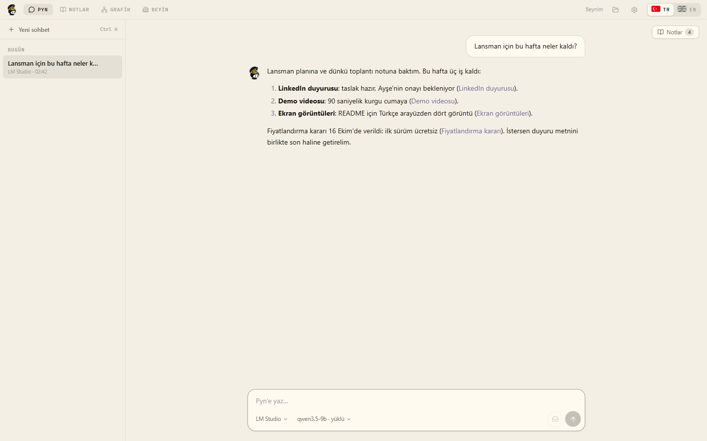
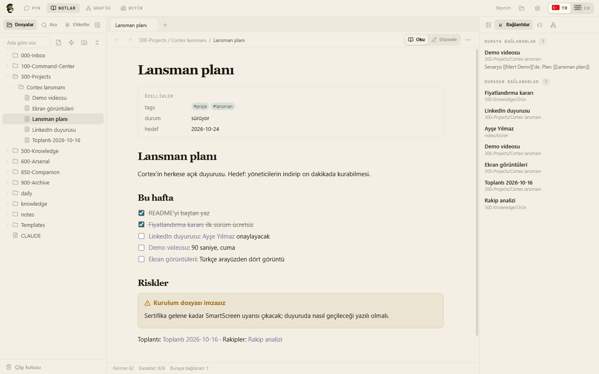
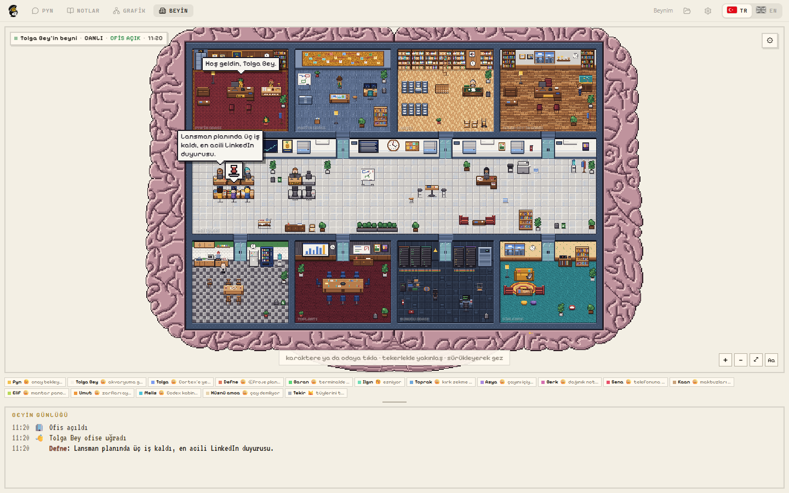
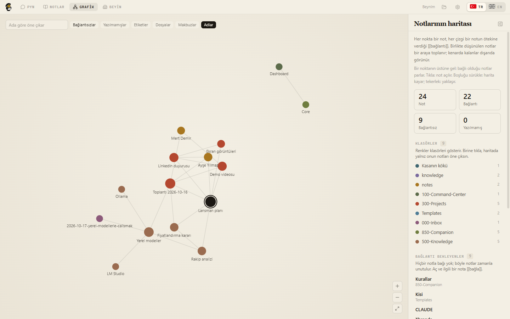
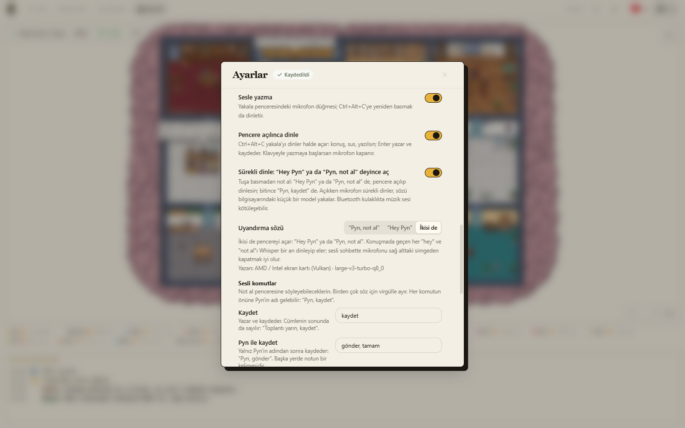
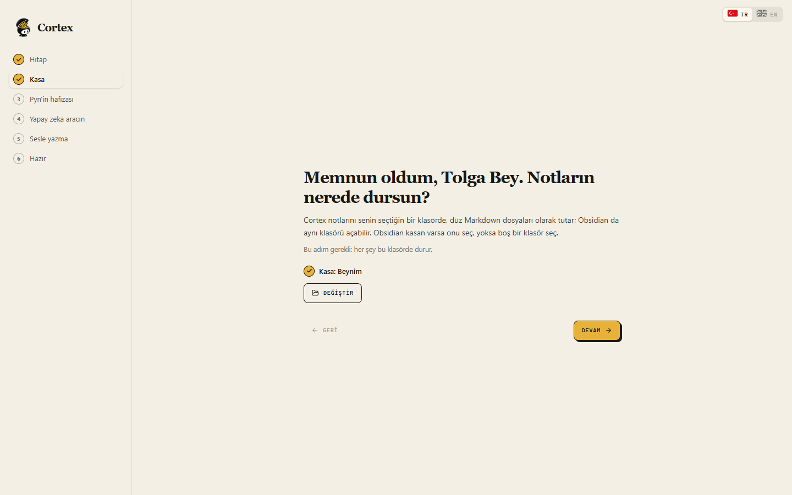
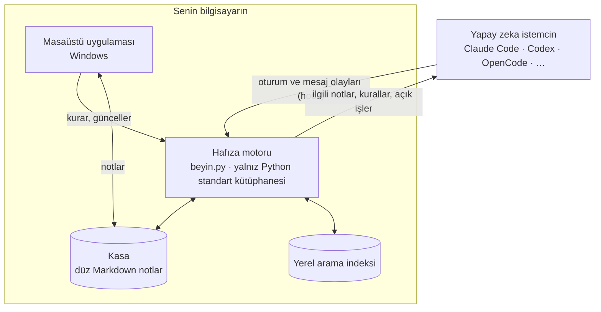

<p align="center">
  
</p>

<h1 align="center">Cortex</h1>

<p align="center">
  <b>Yapay zeka asistanların için yerel, kalıcı bir ikinci beyin.</b><br>
  Notların kendi bilgisayarında, düz Markdown dosyalarında kalır.<br>
  Claude Code, Codex, OpenCode, Gemini CLI, Qwen Code, Kiro ve yerel modeller aynı hafızayı paylaşır.
</p>

<p align="center">
  
  
  
  
  
  
</p>

<p align="center">
  <a href="https://github.com/GunduzTolga/Cortex/releases/latest"><b>Windows için indir</b></a> ·
  <a href="#hızlı-başlangıç-windows">Hızlı başlangıç</a> ·
  <a href="docs/KULLANIM.md">Kullanım rehberi</a> ·
  <a href="#in-english">English</a>
</p>

<p align="center">
  
</p>

---

## Cortex nedir?

Yapay zeka asistanları oturum kapanınca unutur; bir araçta anlattığını öbürü bilmez. Cortex bu boşluğu kapatır. Notlarının durduğu bir klasöre (bir Obsidian kasasına ya da sıradan bir klasöre) kurulur ve kullandığın araçlara ortak bir hafıza bağlar.

- **Hatırlar.** Her oturum açılışında ve her mesajda konuyla ilgili notlar asistanın bağlamına eklenir; önceki oturumun devir kartı ve açık konular hep el altındadır.
- **Düzeltmeni unutmaz.** "Bunu böyle yapma" dediğinde asistan bunu kural olarak yazar; sonraki oturum o kuralı bilerek başlar.
- **Kaynak gösterir.** Biten işler kısa, kaynak bağlantılı makbuzlarla kaydedilir; neyin nereden geldiği izlenebilir.
- **Araçtan bağımsızdır.** Claude Code'da kaydettiğini Codex'te, OpenCode'da ya da LM Studio'daki yerel bir modelde bulursun.
- **Senin dosyalarındır.** Her şey düz Markdown'dır; Obsidian'la, Cortex'in kendi not ekranıyla ya da herhangi bir editörle açılır.
- **Yereldir.** Hafıza motoru hesap, API anahtarı ya da sürekli açık bir sunucu istemez; kendi başına hiçbir model çağırmaz, telemetri toplamaz.

Cortex'le birlikte bir düşünme ortağı gelir: ananas **Pyn**. Seni tanır, fikirlerine gerekçeli itiraz eder, işlerini takip eder ve öğrendiklerini düzenler. Kimliği ve hafızası kasandaki Markdown dosyalarındadır.

## Öne çıkanlar

| | |
| --- | --- |
| **Ortak hafıza** | Desteklenen her istemci aynı notları, kararları ve açık işleri görür; hafıza modele değil istemciye bağlıdır, yerel modeller de tam hafızayla çalışır. |
| **Masaüstü uygulaması** | Terminalsiz kurulum. Pyn'le kendi yapay zeka aracın üzerinden sohbet, Obsidian'sız not okuma ve yazma, not grafiği. |
| **Beyin** | Pyn'in ekibinin bir beynin içine çizilmiş piksel sanatı ofiste çalıştığı ekran; istersen ekip son notların hakkında konuşur. |
| **Not al ve sesle yazma** | Her uygulamanın üstünde `Ctrl+Alt+C` ile açılan pencere; Windows'ta "Pyn, not al" ya da "Hey Pyn" demek de açar. Ses yerel Whisper ile yazıya dökülür, bilgisayardan çıkmaz. |
| **Yakala** | Tarayıcıdaki sayfa, video, makale, ekran görüntüsü ya da dosya tek tuşla kasaya; asistan metni çıkarıp derslerini notlara bağlar. |
| **Telegram** | Telefondan kendi botuna gönderdiğin yazı, bağlantı, fotoğraf, dosya ya da sesli not gelen kutusuna düşer. |
| **Birden çok cihaz** | Kasa bağlı olduğu git deposuyla (örneğin GitHub) eşitlenir: bir bilgisayarda yazılan not sunucuya ve öbür cihazlara gider. Ayarlar › Sunucu'da tek anahtar; sır taraması ve çakışmada üstüne yazmama. |
| **Gizlilik** | Notlar ve arama indeksi senin bilgisayarında. Özel işaretli notlar ve hassas adlı klasörler otomatik bağlama girmez. |

## Görüntüler

<table>
  <tr>
    <td width="50%"><br><sub><b>Notlar:</b> Obsidian'sız okuma ve yazma; wiki bağlantıları, görevler, uyarı kutuları, geri bağlantılar.</sub></td>
    <td width="50%"><br><sub><b>Beyin:</b> Pyn'in ekibi beynin içindeki ofiste çalışır; son notların hakkında konuşabilirler.</sub></td>
  </tr>
  <tr>
    <td width="50%"><br><sub><b>Grafik:</b> notların ve aralarındaki bağlantılar; yanındaki rehber bağlantı bekleyen ve yazılmayı bekleyen notları gösterir.</sub></td>
    <td width="50%"><br><sub><b>Sesle yazma:</b> "Pyn, not al" ya da "Hey Pyn"; sesli komutların sözleri Ayarlar'dan değişir.</sub></td>
  </tr>
</table>

<sub>Görüntüler uygulamanın kendisinden, örnek bir kasayla ve gizli bir pencerede alındı (`desktop/e2e/vitrin.mjs`). Sohbetteki cevabı ve Beyin'deki konuşmayı, LM Studio'nun yerine geçen bir test sunucusu yazdı.</sub>

## Hızlı başlangıç (Windows)

Terminal gerekmez; uygulama gerekeni kendisi kurar.

1. **İndir.** [Son sürüm sayfasından](https://github.com/GunduzTolga/Cortex/releases/latest) `Cortex-Setup-X.Y.Z.exe` dosyasını indir.
2. **Kur.** Yönetici izni istemez; yalnız senin kullanıcın için kurulur.
   > Kurulum dosyası henüz kodla imzalı değil. Windows **"Windows bilgisayarınızı korudu"** ekranını gösterirse **Ek bilgi** → **Yine de çalıştır**.
3. **İlk kurulum ekranını izle.** Pyn sırayla sorar ve kurar:
   - sana nasıl hitap edeceğini,
   - notlarının duracağı klasörü (kasa; mevcut bir Obsidian kasası da olur),
   - gerekiyorsa Python'u (uygulamayla gelir),
   - Pyn'in hafızasını (notlarına dokunulmaz),
   - yapay zeka aracını ve girişini (Claude Code kurulu değilse uygulamadan kurulur),
   - isteğe bağlı sesle yazmayı.

   İsteğe bağlı adımlar **Atla** ile geçilir ve sonra Ayarlar'dan yapılır.

   
4. **Konuş.** Pyn sekmesinde aracını seç ve yaz. İlk mesaj için öneri: *"Beni tanımak için kısa sorular sor; cevapları notlarıma kaydet."*

macOS ve Linux'ta hafıza motoru terminalden kurulur: [Terminalden kurulum](docs/KULLANIM.md#terminalden-kurulum-macos-linux-geliştiriciler).

## Nasıl çalışır?



Cortex iki parçadır:

1. **Hafıza motoru (kasada).** Kasaya kurulan küçük bir Python programı. Notlarını yerel bir arama indeksine alır; kullandığın istemciye kurulan hook'lar (oturum ve mesaj olaylarında çalışan küçük komutlar) sayesinde ilgili notları asistanın bağlamına ekler, iş bitince kaynak bağlantılı kayıt tutar. Windows, macOS ve Linux'ta çalışır.
2. **Masaüstü uygulaması (Windows).** Motoru ve gerekenleri terminalsiz kurar; sohbet, notlar, grafik, Beyin, sesle yazma ve Telegram'ı tek pencerede toplar. Uygulama olmadan da motor terminalden kurulup kullanılabilir.

<details>
<summary><b>Kasadaki klasörler</b></summary>

| Klasör | Ne durur |
| --- | --- |
| `📥 000-Inbox/` | Ham yakalamalar: `Dump/` hızlı notlar, `Yakala/` Not al, Yakala ve Telegram'dan gelenler |
| `🎯 100-Command-Center/` | Ana sayfa (`Dashboard.md`) |
| `🏰 300-Projects/` | Proje notları |
| `🧠 500-Knowledge/` | Senin yazdığın kalıcı bilgi |
| `🛠️ 600-Arsenal/` | Araçlar, kişiler, kaynaklar |
| `🔮 850-Companion/` | Pyn'in hafızası: kimliği (`Core.md`), son oturumlar, açık konular, kurallar, günlük |
| `📦 900-Archive/` | Biten ve park edilen işler |
| `📋 Templates/` | Not şablonları |
| `knowledge/`, `daily/` | Asistanın derlediği bilgi tabanı ve oturum kayıtları (makbuzlar) |

</details>

## Desteklenen istemciler

Hafızayı model değil istemci taşır; ücretsiz, uygun fiyatlı ya da yerel modellerin hepsi tam hafızalı bir istemcinin içinden kullanılabilir.

| İstemci | Hafıza | Kurulumun yazdığı |
| --- | --- | --- |
| **Claude Code** | Tam | `.claude/settings.local.json` |
| **Codex** | Tam | `.codex/hooks.json` (ilk açılışta `/hooks` ile onayla) |
| **OpenCode** | Tam | `.opencode/plugins/beyin-v3.js`; z.ai GLM, OpenRouter, LM Studio, Ollama ve diğerleri. [Ayrıntılar](docs/v3/OPENCODE.md) |
| **Gemini CLI** | Tam | `.gemini/settings.json` (API anahtarıyla) |
| **Qwen Code** | Tam | `.qwen/settings.json` |
| **Kiro** (IDE 1.x, CLI) | Tam | `.kiro/hooks/beyin-v3.json`, `.kiro/skills/`. [Ayrıntılar](docs/v3/KIRO.md) |
| **Oh My Pi (OMP)** | Tam | `.omp/hooks/pre/beyin-v3.ts`. [Ayrıntılar](docs/v3/OMP.md) |
| **Hermes Agent** | Tam | Kasaya yazılan eklenti. [Ayrıntılar](docs/v3/HERMES.md) |
| **Google Antigravity** | Oturum başında | `.agents/hooks.json` |
| **Cursor Agent** | Talimatla | `AGENTS.md`'yi okuyup hafıza dosyalarını kendisi yükler |

**Tam hafıza:** hook'lar hafızayı her oturum açılışında ve her mesajda bağlama ekler. Kurulum bu dosyalardaki diğer ayarlarına dokunmaz.

## Gizlilik

Cortex notlarını kendi başına hiçbir yere göndermez ve telemetri toplamaz.

- **Tek otomatik ağ isteği:** GitHub'a sorulan "yeni sürüm var mı?" sorusu; not ya da hesap bilgisi taşımaz ve kapatılabilir. Geri kalan her istek senin başlattığın bir işten gelir (Yakala, sesle yazma kurulumu, güncelleme, Telegram).
- **Asıl akış:** mesajınla eşleşen notlar asistanın bağlamına eklenir ve böylece kullandığın yapay zeka sağlayıcısına gider. Yerel bir model kullanırsan hiçbir şey bilgisayardan çıkmaz.
- **Neyin gitmeyeceğini sen seçersin:**
  - `visibility: private` işaretli notlar otomatik bağlama girmez.
  - Adında "Şifreler", "Özel", "Finans" gibi sözcükler geçen klasörler indekse hiç girmez.
  - İstersen sır süzgeci API anahtarı ve parola gibi sırları maskeler.
- **Ses** bilgisayardan çıkmaz ve diske yazılmaz. **API anahtarları** Windows'un şifreli deposunda durur, kasaya girmez.

Tam açıklama: [Gizlilik ve güvenlik](docs/KULLANIM.md#gizlilik-ve-güvenlik).

## Belgeler

| Belge | İçerik |
| --- | --- |
| [Kullanım rehberi](docs/KULLANIM.md) | Masaüstü uygulaması, Not al ve sesle yazma, Yakala, Telegram, komutlar, güncelleme, sorun giderme |
| [Yakala](docs/v3/YAKALA.md) · [Telegram](docs/v3/TELEGRAM.md) | Yakalama ve telefondan gelen kutusu, ayrıntılarıyla |
| [Güncelleme ve geri alma](docs/v3/UPDATE.md) | Sürüm paketi, doğrulama, kurtarma |
| [Tercihler](docs/v3/PREFERENCES.md) · [Birden çok makine](docs/v3/MULTI-MACHINE.md) | Motorun ayarları; aynı kasayı birkaç bilgisayarda kullanmak |
| [Kaynak formatı](docs/v3/MARKDOWN.md) · [Runtime](docs/v3/RUNTIME.md) | Notların ve motorun iç yapısı |
| [Masaüstü uygulaması](desktop/README.md) | Uygulamayı derlemek ve geliştirmek |
| [Sürüm geçmişi](docs/v3/releases/README.md) | Her sürümün notu |

## Son sürümler

| Sürüm | Öne çıkan |
| --- | --- |
| [1.0.51](docs/v3/releases/1.0.51.md) | Giriş yalnız tarayıcıda: Claude Code ve Codex'in girişi terminal penceresi göstermeden açılıyor, giriş bitince Cortex onu kendisi kapatıyor. Giriş yap'a yeniden basmak tarayıcıyı yeniden açıyor. |
| [1.0.50](docs/v3/releases/1.0.50.md) | OpenCode'a yalnız OpenCode Go API anahtarıyla bağlanılıyor; ilk açılışta anahtar soruluyor. Her araçta tek "Sil" aracı sıfırlıyor, "Ekle" yetkilendirmeyi yeniden açıyor ve giriş bitince pencere kendiliğinden "Giriş yapıldı" oluyor. |
| [1.0.49](docs/v3/releases/1.0.49.md) | OpenCode'un "Giriş yap" penceresi açık kalıyor: gerçek bir terminalde açılıyor, menüsü 0,1 saniyede kapanmıyor. opencode.ai'nin tanımadığı anahtar "bir şeyler ters gitti" yerine anahtarın reddi olarak, ne yapılacağıyla söyleniyor. |
| [1.0.48](docs/v3/releases/1.0.48.md) | Cortex'te OpenCode anahtarı kayıtlıyken sohbet Cortex'in kendi OpenCode'uyla çalışıyor: OpenCode 2'nin kendi kayıtlı girişi (süresi dolmuş anahtarıyla) girilen anahtarın önüne geçiyordu. OpenCode'un asıl ret sebebi iki saniyeye kadar bekleniyor. |
| [1.0.47](docs/v3/releases/1.0.47.md) | OpenCode'a API anahtarı Cortex'ten giriliyor ve OpenCode'un kendi kayıtlı girişinin önüne geçiyor. OpenCode bir mesajı reddedince asıl sebebi (örneğin "API anahtarının süresi dolmuş") kendi günlüğünden okunup sohbette gösteriliyor. Aynı araç için giriş penceresi açıkken ikincisi açılmıyor. |
| [1.0.46](docs/v3/releases/1.0.46.md) | Yapay zeka araçları penceresinde **Ekle** ve **Sil**: Sil aracın girişini bu bilgisayardan siler, sohbetten kaldırır ve Cortex'in indirdiği programı siler; Ekle sıfırdan kurar ve girişi açar. Yeni sohbette model ve mod ilk mesajdan önce seçiliyor. OpenCode 1.19'un giriş listesi okunuyor. |
| [1.0.45](docs/v3/releases/1.0.45.md) | OpenCode sohbeti giriş yaptığın sağlayıcının modeliyle başlıyor: OpenCode Go'ya giriş yapılmışken sohbet OpenCode Zen'in modeliyle açılıyor, her mesaj "provider authentication required" ile reddediliyordu. Böyle bir hata artık hangi sağlayıcıya giriş gerektiğini söylüyor. |
| [1.0.44](docs/v3/releases/1.0.44.md) | "Hey Pyn" AMD ekran kartlı dizüstülerde birkaç saniye daha erken duyuluyor: söz işlemcideki küçük modelle denetleniyor, sözün kendisi ayrıca yazıya çevrilmiyor; pilde Windows sesi yavaşlatmıyor; whisper.cpp kapanırsa yeniden başlıyor. Yapay zeka araçları penceresinde sohbetteki araç yeşil "Giriş yapıldı", sohbette olmayan "Cortex'te kullanılmıyor" diyor. "Her şeyiyle sil"den sonra hafıza yeni sürüme güncellenebiliyor. "Hepsini sil" Whisper "Hepsini sildim" yazsa da çalışıyor. |
| [1.0.43](docs/v3/releases/1.0.43.md) | Uygulama kendini güncelliyor: yeni sürüm yayımlanınca arka planda iniyor, "Yeniden başlat"la ya da Cortex kapanırken kuruluyor; kasadaki motor da kendiliğinden güncelleniyor. Silinip yeniden açılan kasada hafıza kuruluyor; OpenCode, Codex, Gemini CLI ve Qwen Code'u Cortex kendisi kuruyor, Node.js gerekmiyor; sohbette yalnız seçtiğin araçlar görünüyor; kaldırırken "her şeyiyle sil" seçeneği var. |
| [1.0.42](docs/v3/releases/1.0.42.md) | İlk açılış kolaylaştı: kasa Belgeler'de kendiliğinden açılıyor; OpenCode, Codex, Gemini CLI ve Qwen Code da uygulamadan kuruluyor; sesle yazma arka planda kuruluyor; kurulum sürerken yanlış "kurulamadı" uyarısı çıkmıyor. Sesli asistanda "Hey Pyn" varsayılan, cümle sonundaki "hepsini sil" çalışıyor, kapatılan kaydın yazısı sonraki pencereye düşmüyor. |
| [1.0.41](docs/v3/releases/1.0.41.md) | Grafiğin yanında bir rehber var: sayılar, klasör renkleri, bağlantı bekleyen ve yazılmayı bekleyen notlar, en çok bağlananlar. Sesin ekran kartı derlemesi kurulum dosyasıyla geliyor; "Mikrofondan ses gelmiyor" kısa bir duraksamada çıkmıyor; sunucudaki asistan araç listesinde "Sunucudaki Pyn". |
| [1.0.40](docs/v3/releases/1.0.40.md) | Kasa bağlı olduğu git deposuyla eşitlenebiliyor: bir bilgisayarda yazılan not sunucuya ve öbür cihazlara gidiyor; Ayarlar › Sunucu'da tek anahtar, sır taraması ve çakışmada üstüne yazmama. |
| [1.0.39](docs/v3/releases/1.0.39.md) | AMD / Intel ekran kartında ses yarı boyutlu modelle (yaklaşık 870 MB) yazıyor; daha çabuk hazır oluyor. |
| [1.0.38](docs/v3/releases/1.0.38.md) | 1.0.37'nin düzeltmeleri yeniden denendi: yeniden açılan sohbet gösterdiği izin moduyla çalışıyor, kilitli sohbet listesi silinmiyor, Windows satır sonlu notlarda başlıklar okunuyor. |
| [1.0.37](docs/v3/releases/1.0.37.md) | Uygulama baştan sona bir kullanıcı gibi denendi; 70'ten fazla sorun düzeltildi. |
| [1.0.36](docs/v3/releases/1.0.36.md) | Sohbette yeni Pyn; uygulama ekranı doldurarak açılıyor; ilk kurulumda giriş durumu görünüyor. |

[Bütün sürümler](docs/v3/releases/README.md)

## Geliştirme

```
Cortex/
├── desktop/    Masaüstü uygulaması: Electron, React, TypeScript
├── template/   Kasaya kurulan motor (template/.claude/scripts/), skill'ler ve başlangıç notları
├── scripts/    Kurucu, sürüm paketi ve test betikleri
├── tests/      Motorun testleri
├── tema/       Ananas teması ve Pyn'in marka dosyaları
└── docs/       Belgeler, sürüm notları, README görselleri
```

- **Motor:** yalnız Python standart kütüphanesiyle yazılır (3.11+). Testler: `python scripts/run_v3_tests.py`. Sesle yazma, kendi sanal ortamında çalışan ayrı bir yardımcıdır; motor onun paketlerini içe almaz.
- **Masaüstü uygulaması:** `desktop/` içinde `npm ci`, ardından `npm run dev` (geliştirme), `npm test` (birim testleri), `npm run e2e` (gizli pencerede uçtan uca testler), `npm run package` (Windows kurulum dosyası). Ayrıntılar: [desktop/README.md](desktop/README.md).
- **Testler:** motorun 2.000'i aşkın testi Windows, macOS ve Linux'ta Python 3.11 ve 3.13 için yazılmıştır; masaüstü uygulamasının birim testleri ve 150'yi aşkın uçtan uca kontrolü vardır.

Arama yerel kelime eşleştirmesi kullanır; genel doğal dil anlama ya da her soruda doğru hatırlama sözü vermez.

## In English

**Cortex is a local, persistent second brain for AI assistants.** Your notes stay on your computer as plain Markdown files, and Claude Code, Codex, OpenCode, Gemini CLI, Qwen Code, Kiro and local models (LM Studio, Ollama) share the same memory. Relevant notes are added to the assistant's context at session start and with each message, finished work is recorded as short source-linked receipts, and corrections you make become rules the next session already knows. The engine is a standard-library Python program that calls no model on its own, needs no account or server, and collects no telemetry.

- **Windows desktop app:** a no-terminal setup that brings Python if needed, chat with your own AI tool inside your notes, a note editor and graph, and *Beyin*, a living pixel-art office inside a brain.
- **Take a note anywhere:** `Ctrl+Alt+C` opens a small window over any app; on Windows, "Pyn, not al" or "Hey Pyn" opens it too. Speech is transcribed locally by Whisper (CUDA, Vulkan or CPU) and never leaves the computer.
- **Capture:** save the open browser page, a screenshot, a video, an article or a file with one key; your assistant extracts the text and links the lessons into your notes.
- **From your phone:** send a text, link, photo, file or voice note to your own Telegram bot and it lands in the vault's inbox.
- **Privacy:** notes marked `visibility: private` and folders named like "Private", "Secret" or "Passwords" never enter automatic context. The only automatic network request is an update check against GitHub, which can be turned off.

The documentation is in Turkish; the desktop app also has an English interface. Download the Windows installer from the [latest release](https://github.com/GunduzTolga/Cortex/releases/latest). On macOS and Linux, install the engine with `python3 scripts/install_v3.py --vault <folder>` from the release package. The installer is not code-signed yet, so Windows SmartScreen may ask you to confirm (**More info → Run anyway**).

## Lisans ve marka

Kod açık kaynaktır: [MIT lisansı](LICENSE). Kullanabilir, değiştirebilir ve dağıtabilirsin. **Cortex** ve **Pyn** adları, Pyn'in mührü ve logo dosyaları lisansın dışındadır: değiştirilmiş bir sürümü kendi adınla ve kendi görsellerinle yayınla. Ayrıntılar: [MARKA.md](MARKA.md).

Bilgi derleme fikri için [Karpathy'nin bilgi tabanı desenine](https://gist.github.com/karpathy/442a6bf555914893e9891c11519de94f) teşekkürler.

---

<p align="center">
  <br>
  <b>Cortex</b>, <a href="https://solelunatech.com"><b>SoleLuna Tech</b></a> tarafından geliştirilir.
</p>
