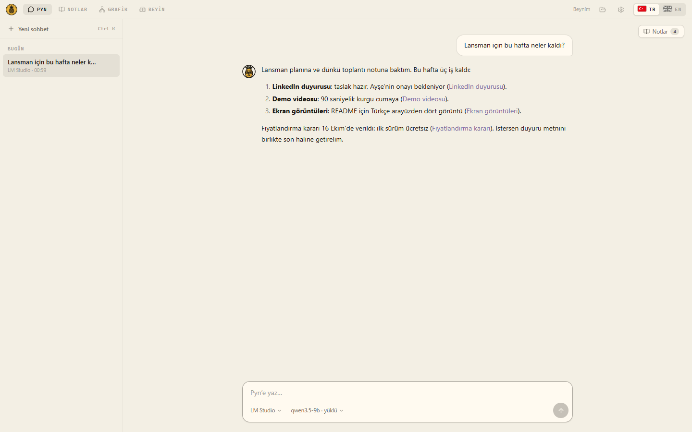
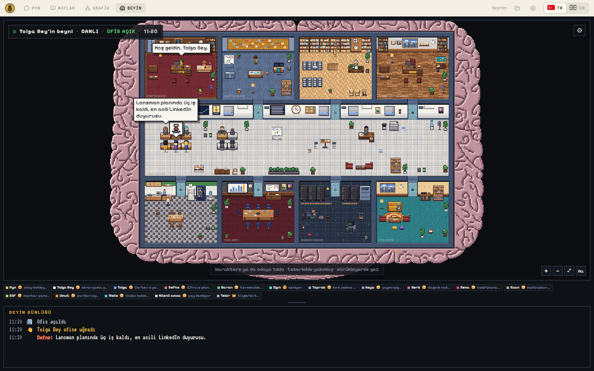
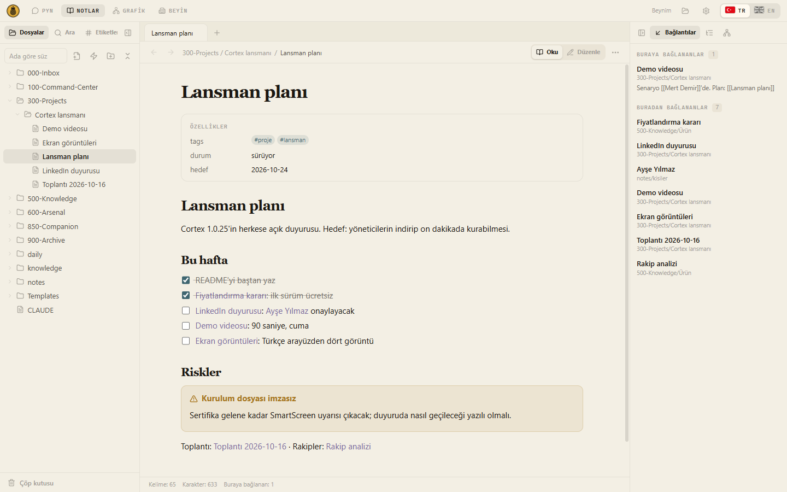
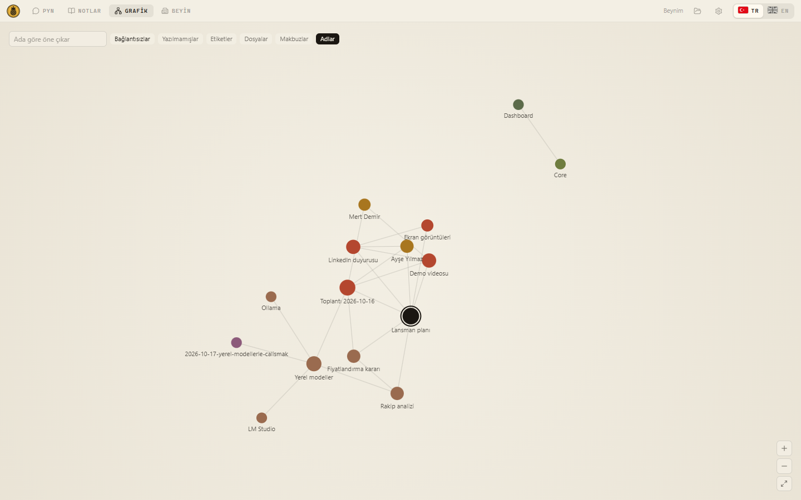
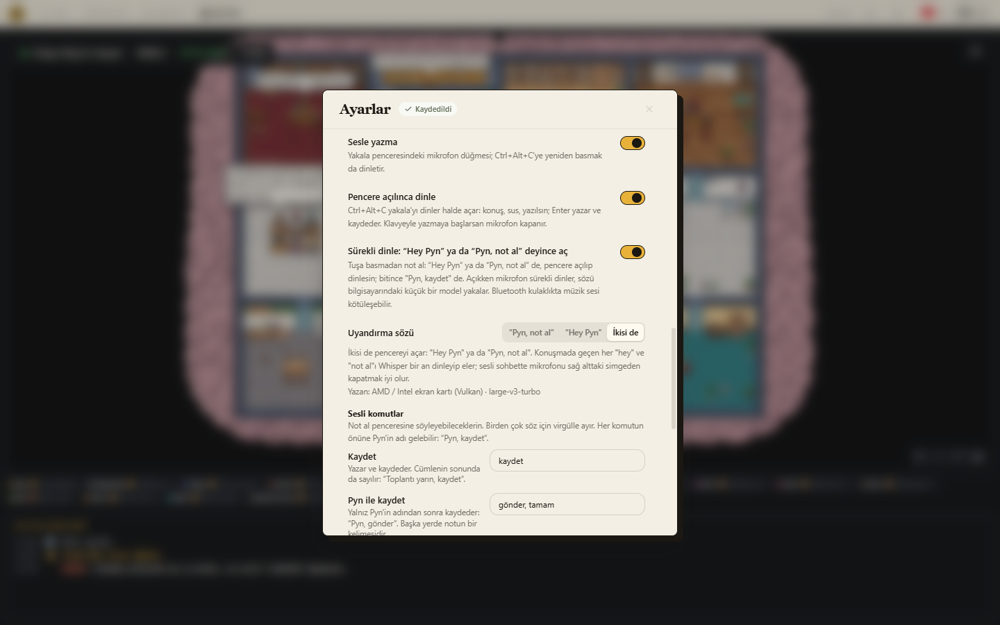
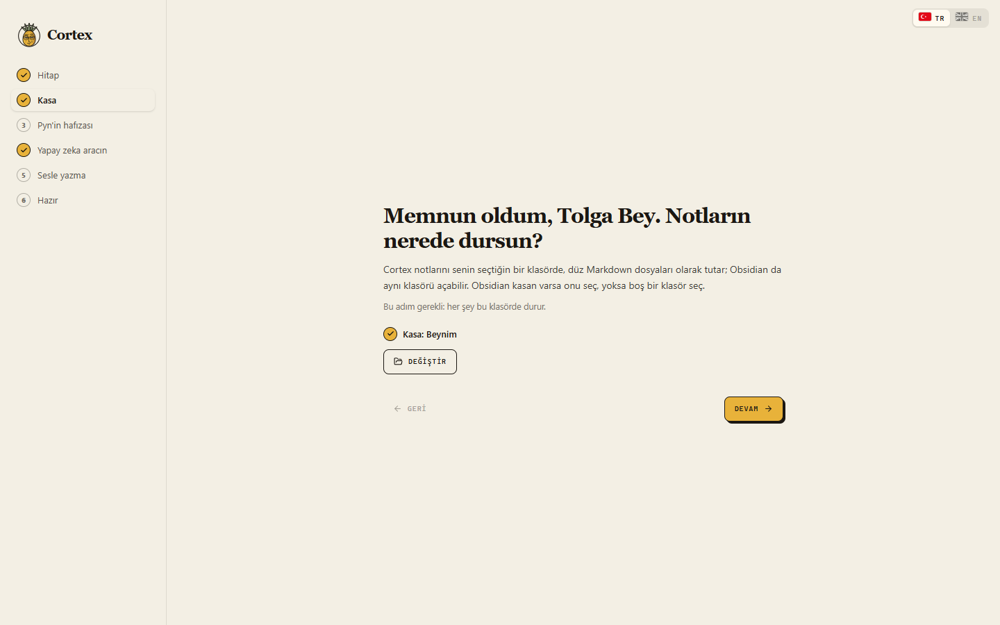

<p align="center">
  
</p>

<h1 align="center">Cortex</h1>

<p align="center">
  <b>Yapay zeka asistanların için yerel, kalıcı bir ikinci beyin.</b><br>
  Notların kendi bilgisayarında, düz Markdown dosyalarında kalır. Claude Code, Codex, OpenCode, Gemini CLI ve yerel modeller aynı hafızayı paylaşır.<br>
  Düşünme ortağın ve maskotu: ananas <b>Pyn</b>.<br>
  <sub>SoleLuna Tech</sub>
</p>

<p align="center">
  
  
  
  
  
</p>

<p align="center">
  <a href="https://github.com/GunduzTolga/Cortex/releases/latest"><b>Windows için indir</b></a> ·
  <a href="#hızlı-başlangıç-windows">Hızlı başlangıç</a> ·
  <a href="#terminalden-kurulum-macos-linux-geliştiriciler">macOS / Linux</a> ·
  <a href="#in-english">English</a>
</p>

<p align="center">
  
</p>

---

## İçindekiler

- [Cortex nedir?](#cortex-nedir)
- [Neler yapar?](#neler-yapar)
- [Görüntüler](#görüntüler)
- [Hızlı başlangıç (Windows)](#hızlı-başlangıç-windows)
- [Masaüstü uygulaması](#masaüstü-uygulaması)
- [Not al ve sesle yazma](#not-al-ve-sesle-yazma)
- [Yakala: tek tuşla beyne at](#yakala-tek-tuşla-beyne-at)
- [Desteklenen istemciler](#desteklenen-istemciler)
- [Gizlilik ve güvenlik](#gizlilik-ve-güvenlik)
- [Terminalden kurulum (macOS, Linux, geliştiriciler)](#terminalden-kurulum-macos-linux-geliştiriciler)
- [Günlük kullanım ve komutlar](#günlük-kullanım-ve-komutlar)
- [Güncelleme](#güncelleme)
- [Sorun giderme](#sorun-giderme)
- [Sürüm geçmişi](#sürüm-geçmişi)
- [Geliştiriciler](#geliştiriciler)
- [In English](#in-english)
- [Lisans ve marka](#lisans-ve-marka)

---

## Cortex nedir?

Yapay zeka asistanları oturum kapanınca unutur; bir araçta anlattığını öbürü bilmez. Cortex bu boşluğu kapatır. Notlarının durduğu bir klasöre (bir Obsidian kasasına ya da sıradan bir klasöre) kurulur ve kullandığın araçlara ortak bir hafıza bağlar:

- **Hatırlar.** Her oturum açılışında ve her mesajda, konuyla ilgili notların asistanın bağlamına eklenir. Önceki oturumun devir kartı, açık konular ve senin düzeltmelerin hep el altındadır.
- **Kaynak gösterir.** Biten işler kısa, kaynak bağlantılı makbuzlarla kaydedilir; neyin nereden geldiği izlenebilir.
- **Araçtan bağımsızdır.** Claude Code'da kaydettiğini Codex'te, OpenCode'da ya da LM Studio'daki yerel bir modelde bulursun.
- **Senin dosyalarındır.** Her şey düz Markdown'dır; Obsidian'la, Cortex'in kendi not ekranıyla ya da herhangi bir editörle açarsın.
- **Yereldir.** Hafıza motoru hesap, API anahtarı ya da sürekli açık bir sunucu istemez; kendi başına hiçbir model çağırmaz ve telemetri toplamaz.

Cortex'in içinde bir düşünme ortağı da gelir: **Pyn**. Seni tanır, fikirlerine gerekçeli itiraz eder, işlerini takip eder ve öğrendiklerini düzenler. Kimliği ve hafızası kasandaki Markdown dosyalarındadır.

## Neler yapar?

| | |
| --- | --- |
| **Ortak hafıza** | Claude Code, Codex, OpenCode, Gemini CLI, Qwen Code, Kiro ve diğerleri aynı notları, kararları ve açık işleri görür. |
| **Masaüstü uygulaması** | Terminal gerektirmeden kurulum; Pyn'le sohbet, notlar, not grafiği ve Pyn'in ekibinin çalıştığı **Beyin** ekranı. |
| **Not al** | Her uygulamada `Ctrl+Alt+C` ya da "Hey Pyn" deyince açılan pencere: yaz ya da konuş, "Pyn, kaydet" de. Ses bilgisayardan çıkmaz. |
| **Yakala** | Video, makale, tweet, ekran görüntüsü ya da tarayıcıdaki sayfa tek tuşla kasaya; asistan metni çıkarıp derslerini notlara bağlar. |
| **Gizlilik** | Notlar ve arama indeksi senin bilgisayarında. Özel notlar ve adında "Şifreler", "Özel" gibi sözcükler geçen klasörler otomatik bağlama girmez. |

## Görüntüler

<table>
  <tr>
    <td width="50%"><br><sub><b>Beyin:</b> Pyn'in ekibi bir beynin içindeki ofiste çalışır; istersen son notların hakkında konuşurlar.</sub></td>
    <td width="50%"><br><sub><b>Notlar:</b> Obsidian'sız okuma ve yazma; wiki bağlantıları, görevler, geri bağlantılar.</sub></td>
  </tr>
  <tr>
    <td width="50%"><br><sub><b>Grafik:</b> notların ve aralarındaki bağlantılar.</sub></td>
    <td width="50%"><br><sub><b>Sesle yazma:</b> "Hey Pyn" ya da "Pyn, not al"; sesli komutların sözleri Ayarlar'dan değişir.</sub></td>
  </tr>
</table>

<sub>Görüntüler uygulamanın kendisinden, örnek bir kasayla alındı (`desktop/e2e/vitrin.mjs`). Sohbetteki cevabı ve Beyin'deki konuşmayı, LM Studio'nun yerine geçen bir test sunucusu yazdı.</sub>

## Hızlı başlangıç (Windows)

Terminal gerekmez; uygulama gerekeni kendisi kurar.

1. **İndir.** [Son sürüm sayfasından](https://github.com/GunduzTolga/Cortex/releases/latest) `Cortex Setup X.Y.Z.exe` dosyasını indir.
2. **Çalıştır.** Kurulum yönetici izni istemez, yalnız senin kullanıcın için standart yere kurulur.
   > **Kurulum dosyası henüz imzasız.** Windows bu yüzden mavi bir **"Windows bilgisayarınızı korudu"** ekranı gösterebilir. **Ek bilgi**'ye, ardından **Yine de çalıştır**'a bas. Kod imzalama sertifikası gelince bu ekran kalkacak.
3. **İlk kurulum ekranını izle.** Pyn önce sana nasıl hitap edeceğini sorar, sonra sırayla:
   1. **Kasa:** notlarının duracağı klasör (mevcut bir Obsidian kasası olabilir).
   2. **Python:** bilgisayarda yoksa kurulum dosyasıyla gelir, yalnız senin kullanıcın için kurulur.
   3. **Pyn'in hafızası:** Cortex kasaya kurulur; notlarına dokunulmaz.
   4. **Yapay zeka aracın:** Claude Code, Codex ve diğerlerinin girişleri.
   5. **Sesle yazma:** isteğe bağlı, tek düğmeyle.

   Her adım ne yaptığını söyler; isteğe bağlı olanlar **Atla** ile geçilir ve sonra Ayarlar'dan kurulur.

   
4. **Konuş.** Pyn ekranında aracını seç ve yaz. İstersen ilk mesajın şu olsun: *"Beni tanımak için kısa sorular sor; cevapları notlarıma kaydet."*

## Masaüstü uygulaması

Dört ekran:

- **Pyn:** kasanın içinde, kendi aracınla sohbet. Araç kasada başladığı için hafıza tam gelir. Araçlar: Claude Code, Codex, OpenCode, Gemini CLI, Qwen Code; yerel modeller için LM Studio ve Ollama (modeli kendi uygulamasında yüklersin, Cortex onunla doğrudan konuşur). Model, mod ve efor çiplerle seçilir; aracın izin istediği adımlar kartla sorulur. Sohbetin okuduğu ve değiştirdiği notlar yan panelde açılır.
- **Notlar:** Obsidian'a gerek kalmadan okuma ve yazma: wiki bağlantıları, canlı önizleme, geri bağlantılar, arama, şablonlar, çöp kutusu. Makbuzlar ve motorun ürettiği sayfalar salt okunurdur.
- **Grafik:** notların ve aralarındaki bağlantılar.
- **Beyin:** bir beynin içine çizilmiş, yaşayan bir piksel sanatı ofis; kıvrımlarında kıvılcımlar akar. Patron Pyn, ilk açılışta yazdığın adı taşıyan müdür, Cortex'i yazan geliştirici Tolga, 12 kişilik ekip ve kedi Tekir dokuz odada çalışır; karakterlere ve odalara tıklanır. Sunucu odasının ışıkları araçlarının gerçek giriş durumunu, odalar kasanın sayılarını gösterir. İstersen ekip son notların hakkında konuşur: Ayarlar → Beyin'den bir araç (LM Studio, Ollama ya da Claude Code) ve model seçersin.

**Sağ alttaki simge.** Pencereyi kapatınca Cortex bildirim alanında kalır ve Windows'la birlikte açılır. Simgenin menüsü: mikrofonun durumu, **Sürekli dinle** aç/kapat, **Not al**, **Cortex'i aç**, **Ayarlar**, **Çık**. İstemezsen Ayarlar → Genel → *Sağ altta çalışmaya devam et*.

**Ayarlar** (üst çubuktaki dişli ya da `Ctrl+,`): dil, hitap, kasa, sağ altta çalışma, dosya ağacının görünüşü, yapay zeka araçlarının girişleri ve API anahtarları, Beyin'in canlı konuşmaları, kasadaki Cortex'in kurulumu ve güncellenmesi, sesle yazma (uyandırma sözü, sesli komutlar). İlk kurulum ekranı da buradan yeniden açılır. Her değişiklikten sonra "Kaydedildi" görünür; yazılan alanların yanında Kaydet düğmesi vardır.

**Girişler ve anahtarlar.** Her araç bu bilgisayarda kayıtlı kendi girişini kullanır, terminaldekiyle aynı giriş. Uygulama bu giriş dosyalarını okumaz, yalnız araca durumunu sorar. Uygulamaya girdiğin API anahtarları Windows'un şifreli deposunda durur; hiçbiri kasaya girmez.

**Güncelleme.** Uygulamanın yeni sürümünü kurduğunda ana ekranda **"Cortex güncellemesi hazır"** bildirimi çıkar; tek tıkla kasadaki hafıza motoru da güncellenir, notlarına dokunulmaz.

Kendin derlemek ve ayrıntılar için: [desktop/README.md](desktop/README.md).

## Not al ve sesle yazma

**Not al** penceresi her uygulamanın üstünde açılır: `Ctrl+Alt+C` (macOS'ta `Control+Option+C`) ya da sağ alttaki simgenin menüsünden **Not al**. Yaz ya da konuş, `Enter` kaydeder, `Esc` vazgeçer. Kayıt kasanın `📥 000-Inbox/Yakala/` klasöründe bir not olur.

**Sesle yazma (Windows, isteğe bağlı).** İlk kurulum ekranından ya da Ayarlar → Sesle yazma'dan tek düğmeyle kurulur.

- Pencere dinler halde açılır: konuş, ara ver, bitince **"Pyn, kaydet"** (ya da "Pyn, gönder", "Pyn, tamam") de; tuşa basmadan kaydedilir.
- **Sürekli dinle** açıkken uyandırma sözü pencereyi açar: **"Hey Pyn"**, **"Pyn, not al"** ya da ikisi de (Ayarlar → Sesle yazma → Uyandırma sözü). Pyn'in adını her seferinde yerel Whisper doğrular; sohbetteki bir "hey" pencere açmaz.
- Sesli komutlar: **"panodaki resmi ekle"** (son kopyalanan görüntüyü nota ekler), **"son kelimeyi sil"**, **"son cümleyi sil"**, **"hepsini sil"**, **"iptal"**. Komutların sözleri Ayarlar'dan değiştirilir.
- Ses bilgisayardan çıkmaz ve diske yazılmaz; yerel Whisper yazıya döker. NVIDIA (CUDA), AMD Radeon ve Intel Arc (Vulkan) kartlarda ekran kartında, yoksa işlemcide çalışır.

[Ayrıntılar](docs/v3/YAKALA.md#sesle-yazma-windows-isteğe-bağlı)

## Yakala: tek tuşla beyne at

Video, tweet, makale, mail ya da dosyayı gördüğün yerde yakala; asistanına "yakalananları işle" de, metni çıkarıp derslerini `knowledge/` notlarına bağlasın.

- **Tarayıcıdaki sayfa (Windows):** Chrome, Edge, Brave, Vivaldi ya da Opera öndeyken kısayola basarsan açık sayfanın bağlantısı gelir. Pencerede **Bu sayfayı nota bağla** işaretlidir; `Alt+S` ile kaldırırsan not düz not olarak kaydedilir.
- **Ekran görüntüsü:** `Win+Shift+S` ile alan seç, sonra kısayola bas; görüntü küçük resmiyle nota eklenir.
- **Pano:** yalnız son kayıttan sonra kopyaladığın metin nota işaretli gelir. Daha önce kopyalanmış metin (saatler önceki bir parola gibi) seçenek olarak durur, `Tab` ile eklenir.
- **YouTube:** döküm videoda konuşulan dilde alınır; altyazı yoksa ses yalnız yerelde Whisper ile yazıya dökülür.
- **Tarayıcı eklentisi:** Obsidian Web Clipper'ın "Beyne at" şablonu; giriş isteyen sayfalar da yakalanır. Windows'ta dosyaya sağ tık → Gönder → **Beyne At**.

[Ayrıntılar](docs/v3/YAKALA.md)

## Desteklenen istemciler

Hafızayı model değil istemci taşır. Bu yüzden ücretsiz, uygun fiyatlı ya da yerel modellerin hepsi, tam hafızalı bir istemcinin içinden kullanılabilir.

| İstemci | Hafıza | Not |
| --- | --- | --- |
| **Claude Code** | Tam | Hook'lar her oturumda ve her mesajda bağlam ekler. |
| **Codex** | Tam | İlk açılışta `/hooks` ekranında hook'ları inceleyip güven. |
| **OpenCode** | Tam | z.ai GLM, OpenCode Go ve Zen aboneliği, OpenRouter ve yerel modeller (LM Studio, Ollama). Eklenti kurulumla gelir. [Ayrıntılar](docs/v3/OPENCODE.md) |
| **Gemini CLI** | Tam | Hook'lar `.gemini/settings.json` dosyasına yazılır. Google bireysel hesapla girişi kapattı; API anahtarıyla kullan. |
| **Qwen Code** | Tam | Hook'lar `.qwen/settings.json` dosyasına yazılır. |
| **Kiro** (IDE 1.x, CLI) | Tam | Kurulum `.kiro/hooks/beyin-v3.json` ve `.kiro/skills/` yazar; IDE'de Agent Hooks panelinden, CLI'da `/hooks` ile incele. [Ayrıntılar](docs/v3/KIRO.md) |
| **Oh My Pi (OMP)** | Tam | Kurulum `.omp/hooks/pre/beyin-v3.ts` dosyasını yazar. [Ayrıntılar](docs/v3/OMP.md) |
| **Hermes Agent** | Tam | Eklenti kasaya yazılır; etkinleştirme adımını sen yaparsın. [Ayrıntılar](docs/v3/HERMES.md) |
| **Google Antigravity** | Oturum başında | Hafıza ilk model çağrısında eklenir, tur sonları kaydedilir; mesaj başına bağlam yoktur. |
| **Cursor Agent** | Talimatla | `AGENTS.md`'yi okur ve hafıza dosyalarını kendisi yükler; otomatik bağlam yoktur. |

**Tam hafıza:** hook'lar Pyn'in hafızasını her oturum açılışında ve her mesajda bağlama ekler, dosya düzenlenen oturumun sonunda makbuz hatırlatır. Codex, Gemini CLI, Qwen Code ve Kiro'da hook'ları ilk açılışta inceleyip onayla. O dosyalardaki diğer ayarların korunur.

## Gizlilik ve güvenlik

Cortex notlarını kendi başına hiçbir yere göndermez ve telemetri toplamaz. Tek otomatik ağ isteği, günde en çok bir kez GitHub'a sorulan "yeni sürüm var mı?" sorusudur; not, prompt ya da hesap bilgisi taşımaz (`preferences --update-notifications off` kapatır).

Asıl akış şudur: yazdığın mesajla eşleşen notlar asistanının bağlamına eklenir ve böylece **kullandığın yapay zeka sağlayıcısına** (Anthropic, OpenAI, Google…) gider. Sistemin amacı budur. Neyin gitmeyeceğini sen belirlersin:

- **Tek bir not:** notun en başına şu üç satırı koy; not otomatik bağlama hiç girmez, yalnız açıkça istediğinde okunur.

  ```
  ---
  visibility: private
  ---
  ```

- **Hassas klasörler:** adında `Kasa`, `Şifreler`, `Parola`, `Kimlik`, `Finans`, `Müşteriler`, `Vergi`, `Fatura`, `Maaş`, `Özel`, `Gizli`, `Private`, `Secret` gibi bir sözcük geçen klasörler ve alt klasörleri indekse hiç girmez (Türkçe harf ve büyük/küçük harf fark etmez); Obsidian'da görünmeye devam ederler. Asistanın böyle bir klasördeki notu görmesini istiyorsan klasörün adını değiştir. Başka bir klasörü dışarıda tutmak için `preferences --index-exclude-dir <ad>`. Nokta ile başlayan klasörler (`.gizli/`) de indekslenmez.
- **Ayrı kasa:** sağlık ya da finans gibi notlar için Cortex'i kurmadığın ayrı bir kasa en temiz yoldur.
- **Sır süzgeci:** `preferences --secret-filter on`, asistanın yazdığı notlarda, makbuzlarda ve görevlerde API anahtarı ve parola gibi sırları maskeler. Varsayılan kapalıdır.
- **Beyin'in canlı konuşmaları:** Claude Code'la açarsan son notlarının başlıkları ve kısa parçaları ona gider; LM Studio ya da Ollama'da bilgisayardan çıkmaz. Varsayılan kapalıdır.
- **Yakalanan içerik:** dışarıdan gelen metin veri olarak, güvenilmeyen kaynak işaretiyle tutulur; yalnız herkese açık `http(s)` adresleri getirilir, yerel ve özel ağ adresleri reddedilir. [Ayrıntılar](docs/v3/YAKALA.md#güvenlik)

Arama indeksi kasanın dışında, yalnız senin hesabının okuyabildiği bir klasörde durur (Windows: `%LOCALAPPDATA%\beyin-v3\…`, macOS: `~/Library/Application Support/beyin-v3/…`, Linux: `~/.local/state/beyin-v3/…`) ve notlarının bir kopyasını içerir. Kasayı herkese açık bir git deposuna koyacaksan `.beyin-runtime.json` dosyasını dışarıda bırak: bu makinedeki tam yolu içerir ([birden çok makine](docs/v3/MULTI-MACHINE.md)).

## Terminalden kurulum (macOS, Linux, geliştiriciler)

Masaüstü uygulaması Windows içindir ve gerekeni kendisi kurar. macOS ve Linux'ta, ya da uygulamasız kullanmak istersen hafıza motoru terminalden kurulur. **Gereksinim:** Python 3.11 veya üzeri ve kullandığın yapay zeka istemcisi. İki yol da mevcut notlarına dokunmaz; Cortex zaten kuruluysa notlarını koruyarak günceller.

**Yol 1: Asistanına kurdur.** Kasa klasörünü Claude Code, Codex ya da Antigravity ile aç ve şunu yapıştır:

> https://raw.githubusercontent.com/GunduzTolga/Cortex/main/beyin.md adresini oku. Bu klasöre ikinci beynimi kur. Mevcut kurulum varsa notlarımı koruyarak güncelle. Gerekli indirme ve kurulum adımlarını sen yap. Sonunda örnek bir bilgiyi kaydedip yeni oturumda geri okuyarak birlikte doğrulayalım.

Asistan kararlı paketi bulur, checksum ile doğrular, kurar ve sağlık kontrolünü çalıştırır. Sana yalnız istemcinin gösterdiği klasör ya da hook güven onayını vermek kalır.

**Yol 2: Elle kur.** [Son sürüm sayfasından](https://github.com/GunduzTolga/Cortex/releases/latest) `beyin-v3-X.Y.Z.zip` paketini ve yanındaki `.sha256` dosyasını indir (GitHub'ın otomatik "Source code" arşivini değil), bir klasöre aç ve:

```sh
python3 scripts/install_v3.py --vault "/tam/yol/Beynim"      # macOS / Linux
py -3 scripts/install_v3.py --vault "C:\Notlar\Beynim"        # Windows
```

Kurucu istemci bağlantılarını, ortak motoru, üç başlangıç skill'ini (**beyin**, **beyin-doktor**, **beyin-guncelle**) ve güncelleme kısayolunu kurar. Arama indeksi kasanın dışında tutulur; başka bir yer için `--state "/ayri/klasor"`. [Güncelleme ve runtime rehberi](docs/v3/UPDATE.md)

**Kurulumdan sonra:** kasayı istemcinde aç, hook güvenini onayla (Codex'te `/hooks`) ve asistanına *"Beyin skill'ini kullan. Beni tanımak için kısa sorular sor; cevapları kaynak notlara kaydet."* de. Sağlık kontrolü: `python3 beyin.py doctor`.

**İsteğe bağlı:**

- **`pyn` komutu:** `python3 beyin.py pyn kur` sonrası her terminalde `pyn` yazınca Pyn'in mühürlü karşılama kutusu ve bu makinede kurulu istemcilerin menüsü açılır (yeşil hazır, kırmızı kapalı; yerel modeller dahil). `pyn claude`, `pyn codex` menüsüz açar; `pyn kontrol` eski istemcileri, `pyn guncelle` Cortex'i günceller; `pyn kaldir` her şeyi geri alır.
- **Yakala:** `python3 beyin.py yakala kur` (kısayol `Ctrl+Alt+C` / `Control+Option+C`; değiştirmek için `yakala kisayol`). Sesle yazma terminalden: `py -3 beyin.py ses kur`.
- **Ananas teması:** `python3 beyin.py tema kur`. Obsidian için fildişi kâğıt, mürekkep kontur, sert gölgeli kartlar, Fraunces başlıklar; yazı tipleri temanın içinde gelir. Yalnız `.obsidian/snippets/ananas.css` dosyasını yazar ve etkinleştirir; kenar çubuğunda klasörler sade Türkçe etiketlerle görünür, diskteki adlar değişmez. `tema kaldir` geri alır.

## Günlük kullanım ve komutlar

Notunu yaz, asistanına ne istediğini söyle. Kaynaklar oturum açılışında ve konuşmanın uygun noktalarında yeniden indekslenir. Önemli iş sonuçları kısa, kaynak bağlantılı kayıtlarla tutulur. Sohbetin tamamı kendiliğinden kalıcı bilgiye dönüşmez; kalıcı olmasını istediğin karar ve bilgiyi nota yazdır. Bir şey ters giderse asistanına **"beyin-doktor ile kontrol et"** de.

Kasa klasöründe (Windows'ta `python3` yerine `py -3`):

| İstersen | Komut |
| --- | --- |
| Son 7 günde ne yapıldı? | `python3 beyin.py recap --days 7` |
| Belirli tarih aralığı | `python3 beyin.py recap --since 2026-10-01 --until 2026-10-15` |
| Bekleyenler, unutulan görevler, haftanın notları | `python3 beyin.py triage` |
| Sağlık kontrolü | `python3 beyin.py doctor` |
| Zamanlanmış sağlık kontrolü (Görev Zamanlayıcı için) | `python3 beyin.py scheduled-check --notify` |
| Taşınan ya da başka makineden gelen kasada hook yollarını onar | `python3 beyin.py hook-reconcile` |
| Tercihleri gör | `python3 beyin.py preferences` |

`recap` ve `triage` model çağırmaz. `recap`'teki sonuçlar asistanın yazdığı iddialardır, bağımsız doğrulanmış olgular değildir.

**Hafıza dosyalarının boyutu.** `Last-Session.md` son oturumların devir kartları, `Threads.md` açık konuların güncel durumudur; varsayılan sınırlar 3.000 ve 8.000 karakter. Sınır aşılınca oturum `Memory hygiene:` uyarısıyla açılır ve asistan `beyin.py companion-compact` çalıştırır: eski bölümler kelimesi kelimesine `Arşiv/` altına taşınır, kararlar `Kararlar.md`'ye de eklenir. Hiçbir metin silinmez ya da özetlenmez, model çağrılmaz. [Ayrıntılar](docs/v3/COMPANION-PARITY.md)

**Tüketim.** Asistanına "ekonomik moda geç", "otomatik kontrolleri kapat" ya da "kontrol aralığını 30 dakika yap" diyebilirsin.

| Mod | Yerel kontrol | Oturuma eklenen bağlam |
| --- | --- | --- |
| Normal (varsayılan) | Her ilgili istemci olayında | Oturum başında ve mesajlarda, en çok 5.000 karakter |
| Ekonomik | Yeni oturumda; sonra en az 15 dakika arayla | Yalnız oturum başında, en çok 2.000 karakter |
| Manuel | Otomatik kapalı | Otomatik kapalı |

İsteğe bağlı: `preferences --context-dedupe on` aynı oturumda değişmemiş notları yeniden göndermez; küçük bağlamlı yerel modellerde yer açar. [Tüm tercihler](docs/v3/PREFERENCES.md)

## Güncelleme

- **Masaüstü uygulamasıyla:** yeni sürümü kur, aç; ana ekrandaki **"Cortex güncellemesi hazır"** bildiriminde **Güncelle** (ya da Ayarlar → Cortex).
- **Terminalden:** `pyn guncelle`, ya da kasada `python3 beyin.py update` (yalnız bakmak için `update --check`). Asistanına "beynimi güncelle" demek ya da kasadaki `Beyni Guncelle.cmd` kısayolu da aynı işi yapar.

Güncelleme yalnız resmi kararlı sürüm paketinden yapılır. Paket önce doğrulanır (checksum, manifest, dosya hash'leri), notlarına dokunmadan ayrı bir deneme kasasında çalıştırılır ve ancak bundan sonra uygulanır. Bir kesintiden sonra `recover`, geri dönmek için `rollback`. İnternetsiz güncelleme: `update --package "/indirilen/beyin-v3-X.Y.Z.zip"`. [Güncelleme rehberi](docs/v3/UPDATE.md)

## Sorun giderme

| Belirti | Çözüm |
| --- | --- |
| Kurulumda "Windows bilgisayarınızı korudu" | Kurulum dosyası henüz imzasız. **Ek bilgi** → **Yine de çalıştır**. |
| "Hey Pyn" pencereyi açmıyor | Ayarlar → Sesle yazma: **Sürekli dinle** açık mı, uyandırma sözü "Hey Pyn" ya da "İkisi de" mi? Sağ alttaki simgenin menüsü mikrofonun dinleyip dinlemediğini söyler. |
| Asistan notları hatırlamıyor | İstemcide hook güvenini onayladığını kontrol et, sonra asistana "beyin-doktor ile kontrol et" de ya da `beyin.py doctor` çalıştır. |
| Bir not bağlama hiç girmiyor | Notta `visibility: private` var mı, klasörünün adında "Özel", "Şifreler" gibi bir sözcük geçiyor mu? `beyin.py doctor` indeks dışı tutulanları gösterir. |
| Oturum `Memory hygiene:` uyarısıyla açılıyor | `beyin.py companion-compact` eski kayıtları silmeden arşive taşır. |
| Gemini CLI `IneligibleTierError` veriyor | Google bireysel hesapla girişi kapattı; API anahtarıyla giriş yap. |
| cmd'de `pyn` çalışmıyor | `pyn kur`u yeniden çalıştır, sonra **yeni** bir terminal aç. |

**Eski bir kurulumdan geliyorsan** (Cortex'in doğduğu açık kaynak projenin eski sürümleri): aynı kurucuyu mevcut kasa üzerinde bir kez çalıştır. Notlar, companion dosyaları, `daily/` ve `knowledge/` içerikleri korunur; tanınan eski yazıcılar geri alınabilir biçimde devreden çıkarılır. [Geçiş ayrıntıları](docs/v3/MIGRATION.md)

## Sürüm geçmişi

| Sürüm | Öne çıkan |
| --- | --- |
| [1.0.25](docs/v3/releases/1.0.25.md) | Öncülün 3.10 ve 3.11 motoru: BOM ve hassas klasör gizliliği, uzun Kurallar.md, daha iyi arama, Kiro, `scheduled-check`, `triage`; Yakala'da açık sayfanın bağlantısı, pano tazeliği, videonun konuşulan dili. |
| [1.0.24](docs/v3/releases/1.0.24.md) | İlk açılışta sesli uyandırma çalışmıyordu (kulaklık hazır değilken mikrofon açılamayınca kapanıyordu): artık yeniden deniyor, sonradan bağlanan kulaklığı da buluyor. |
| [1.0.23](docs/v3/releases/1.0.23.md) | Uyandırma sözü "İkisi de" olabilir; "panodaki resmi ekle" son kopyalanan görüntüyü nota ekler. |
| [1.0.22](docs/v3/releases/1.0.22.md) | Uyandırma sözü seçilebilir: "Pyn, not al" ya da "Hey Pyn"; ikisi de Not al penceresini açar, Whisper Pyn'in adını doğrular. |
| [1.0.21](docs/v3/releases/1.0.21.md) | Canlı konuşmalar düşünen modellerle de yazılıyor (qwen3.5); "Ofis" sekmesi "Beyin" oldu; sağ alttaki menüde mikrofonun durumu, Not al ve Ayarlar, her satırda simge. |
| [1.0.20](docs/v3/releases/1.0.20.md) | Ayarlar her değişikliği kaydettiğini söylüyor ("Kaydedildi"), yazılan alanların yanında Kaydet düğmesi; kurulum konum sormadan standart yere kuruluyor. |
| [1.0.19](docs/v3/releases/1.0.19.md) | Beynin içindeki ofis: harita bir beynin içinde, kıvrımlarında kıvılcımlar akar; ofis ve müdür ilk açılışta yazılan adı taşır; Cortex'i yazan Tolga kendi masasında. |
| [1.0.18](docs/v3/releases/1.0.18.md) | Ofisin canlı konuşmaları Ayarlar → Ofis'ten de seçilir: araç (LM Studio, Ollama, Claude Code; hangisinin hazır olduğu yazar), model ve sıklık; ofisin kendi ayarlarıyla aynı seçim. |
| [1.0.17](docs/v3/releases/1.0.17.md) | Masaüstü sağ altta: simgenin menüsünden "Sürekli dinle" açılıp kapanır (açıkken simgede kırmızı nokta), pencere kapanınca Cortex orada kalır ve Windows'la başlar; ofisin kişi çipleri gerçekten küçüldü. |
| [1.0.16](docs/v3/releases/1.0.16.md) | Not al: uzun not alt satıra geçer, alan dört satıra kadar büyür; "son kelimeyi sil", "son cümleyi sil", "hepsini sil" komutları; komutların sözleri masaüstünde Ayarlar → Sesle yazma'dan değişir; "Py notal" gibi bitişik yazılan uyandırma sözü nota girmez; mikrofonun adı tam görünür. |
| [1.0.15](docs/v3/releases/1.0.15.md) | Sesli komutlar düzeldi: "Pyn, not al" gerçek bir sesle de açar (küçük model "not al"ı yakalar, Pyn'in adını Whisper doğrular); cümleler arasında mikrofon kapanmaz; "Pyn, kaydet" Whisper'ın uydurduğu satırların arkasında kalmaz; "Pyn, gönder/tamam/bitti" de kaydeder; `ses dene --uyandirma` ne duyduğunu gösterir. |
| [1.0.14](docs/v3/releases/1.0.14.md) | Ofisin canlı konuşmaları gerçek: ofis ayarlarında araç (LM Studio, Ollama, Claude Code) ve model seçilir, model son notlar hakkında ekibe konuşma yazar; kişi çipleri küçüldü, hepsi sığıyor. |
| [1.0.13](docs/v3/releases/1.0.13.md) | "Pyn, not al" "payn" diye söylenince de tutar (dar gramerli dinleme); ofisin hızlanması ve büyük yazıları düzeldi; ilk kurulumda "Sürekli dinle" anahtarı; beynin içindeki ofis için Claude Design brifi. |
| [1.0.12](docs/v3/releases/1.0.12.md) | Not al baştan tasarlandı (geniş, yumuşak kenarlı mikrofon, mikrofon adı ve ses düzeyi, "mikrofondan ses gelmiyor" uyarısı); "Pyn, kaydet" diyene kadar kesintisiz dikte, sürekli dinleme; kısayol Ctrl+Alt+C; ana ekranda Cortex güncelleme bildirimi; Türkçe arayüzde İngilizce cümle kalmadı. |
| [1.0.11](docs/v3/releases/1.0.11.md) | Ctrl+Alt+B penceresi yenilendi: "Not al", yazılı mikrofon düğmesi, pencere dinler halde açılır ve ne yapacağını söyler, Enter yazıp kaydeder. İlk kurulum ekranı kayıtlı girişleri "hazır" saymaz; kurulum sihirbazı Pyn'in görselleriyle. |
| [1.0.10](docs/v3/releases/1.0.10.md) | Masaüstü uygulaması her şeyi kendisi kurar: ilk kurulum ekranı (hitap, kasa, Python, Pyn'in hafızası, yapay zeka aracı, sesle yazma), kurulum dosyasıyla gelen Python, Ayarlar'da Cortex ve sesle yazma. Ofis kullanıcıya adıyla seslenir. |
| [1.0.9](docs/v3/releases/1.0.9.md) | Sesle yazma AMD Radeon ve Intel Arc kartlarda da ekran kartında (whisper.cpp, Vulkan); NVIDIA'da CUDA, olmazsa işlemci. Pyn'in yeni yüzü: Claude Design'ın vektör çizimi, sohbette ve Obsidian'da. |
| [1.0.8](docs/v3/releases/1.0.8.md) | Masaüstü uygulaması (önizleme): Pyn sohbeti (Claude Code, Codex, OpenCode, Gemini CLI, Qwen Code; yerel modeller için LM Studio ve Ollama), Obsidian'sız notlar, grafik, araç girişleri ve API anahtarları, ayarlar. Yakala'da isteğe bağlı sesle yazma ve "Pyn, not al" (yerel Whisper). |
| [1.0.7](docs/v3/releases/1.0.7.md) | Yakala güvenliği (yalnız herkese açık adresler, Windows komut satırı koruması), Türkçe karakterli kısayollar, `Win+Shift+S` ekran görüntüsü; daha hızlı senkron; `pyn` yeni sürümü haber verir, `pyn guncelle`; marka kuralları. |
| [1.0.6](docs/v3/releases/1.0.6.md) | `pyn kur` Claude Code'a Pyn durum satırı, Windows Terminal'e Pyn profili ekler; menüde yeşil/kırmızı durum noktaları; `pyn kontrol` eski istemcileri bulur; OpenCode 2.x'te de önbellek korunur. |
| [1.0.5](docs/v3/releases/1.0.5.md) | `pyn` karşılama kutusu ve mühürle açılır, cmd'de de çalışır; OpenCode'da önbellek korunur, yerel modeller OpenCode'da açılır. |
| [1.0.4](docs/v3/releases/1.0.4.md) | Gemini CLI ve Qwen Code tam hafızalı. |
| [1.0.3](docs/v3/releases/1.0.3.md) | Yeni `pyn` komutu: Pyn'i her yerden, istediğin istemciyle aç. |
| [1.0.2](docs/v3/releases/1.0.2.md) | Windows'ta yakala penceresi anında açılır, Ananas yazı tipleriyle. |
| [1.0.1](docs/v3/releases/1.0.1.md) | Pyn görünür oldu: Obsidian'da klasör ikonları, mühür ve Pyn'in yüzü. |
| [1.0.0](docs/v3/releases/1.0.0.md) | Cortex: Ananas teması, maskot Pyn, güncellemeler Cortex'in kendi sürümlerinden. |

## Geliştiriciler

[Kaynak formatı](docs/v3/MARKDOWN.md) · [Runtime](docs/v3/RUNTIME.md) · [Semantik test sözleşmesi](docs/v3/SEMANTIC-TEST-CONTRACT.md) · [Sürüm paketi ve güncelleyici](docs/v3/UPDATE.md) · [Birden çok makine](docs/v3/MULTI-MACHINE.md) · [Tercihler](docs/v3/PREFERENCES.md) · [Yakala](docs/v3/YAKALA.md) · [OpenCode](docs/v3/OPENCODE.md) · [Hermes](docs/v3/HERMES.md) · [OMP](docs/v3/OMP.md) · [Kiro](docs/v3/KIRO.md) · [Yakalama sunucusu](docs/v3/INGEST-SERVER.md) · [Masaüstü uygulaması](desktop/README.md)

Arama yerel kelime eşleştirmesi kullanır; genel doğal dil anlama ya da her soruda doğru hatırlama sözü vermez. Motor her sürümde Windows, macOS ve Linux'ta 1.700'ü aşkın otomatik testle ve anlamsal senaryolarla doğrulanır; gerçek istemci kontrolleri [ayrı raporlanır](docs/v3/README.md).

## In English

**Cortex is a local, persistent second brain for AI assistants.** Your notes stay on your computer as plain Markdown files, and Claude Code, Codex, OpenCode, Gemini CLI, Qwen Code, Kiro and local models (LM Studio, Ollama) share the same memory: relevant notes are added to the assistant's context at session start and with each message, finished work is recorded as short source-linked receipts, and corrections you make become rules the next session already knows. The engine calls no model on its own, needs no account or server, and collects no telemetry.

- **Windows desktop app:** a no-terminal setup (it brings Python and installs everything from its first-run screen), chat with your own AI tool inside your notes, a note editor and graph, and *Beyin*, a living pixel-art office inside a brain.
- **Take a note anywhere:** `Ctrl+Alt+C` or saying "Hey Pyn" opens a small window; type or dictate, then say "Pyn, kaydet". Speech is transcribed locally by Whisper on your GPU and never leaves the computer.
- **Capture:** save the open browser page, a screenshot, a video or an article with one key; your assistant extracts the text and links the lessons into your notes.
- **Privacy:** notes marked `visibility: private` and folders named like "Private", "Secret" or "Passwords" never enter automatic context.

The interface and documentation are in Turkish. Download the Windows installer from the [latest release](https://github.com/GunduzTolga/Cortex/releases/latest); on macOS and Linux, install the engine with `python3 scripts/install_v3.py --vault <folder>` from the release package. The installer is not code-signed yet, so Windows SmartScreen may ask you to confirm (**More info → Run anyway**).

## Lisans ve marka

Kod açık kaynaktır: [MIT lisansı](LICENSE). Kullanabilir, değiştirebilir ve dağıtabilirsin. **Cortex** ve **Pyn** adları, Pyn'in mührü ve logo dosyaları ise lisansın dışındadır: değiştirilmiş bir sürümü kendi adınla ve kendi görsellerinle yayınla. Neyin serbest olduğu: [MARKA.md](MARKA.md).

Bilgi derleme fikri için [Karpathy'nin bilgi tabanı desenine](https://gist.github.com/karpathy/442a6bf555914893e9891c11519de94f) teşekkürler.

---

<p align="center">
  <br>
  <b>Cortex</b>, <a href="https://solelunatech.com"><b>SoleLuna Tech</b></a> tarafından geliştirilir.
</p>
