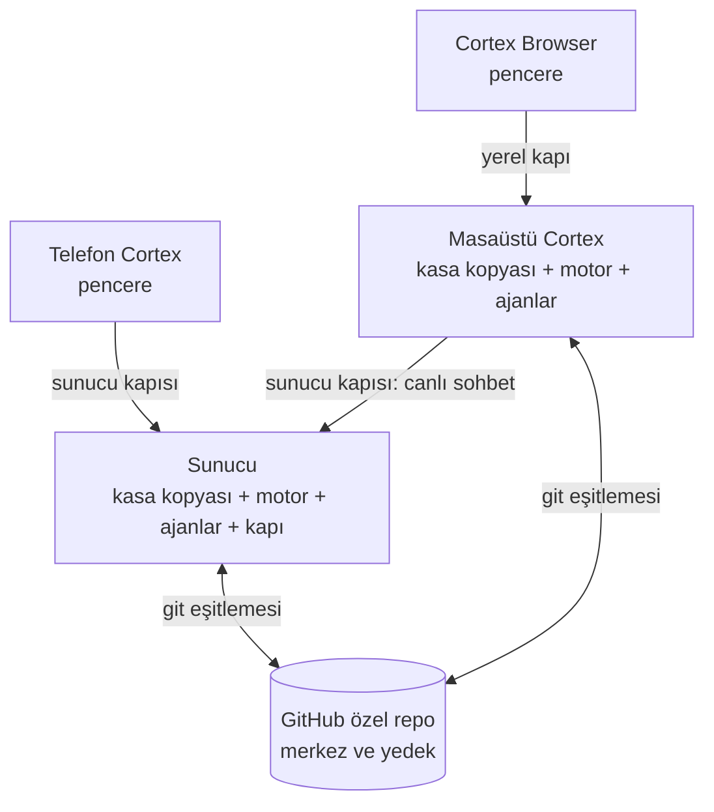

# Telefon, masaüstü, sunucu, tarayıcı: tek Cortex — yol haritası

Tarih: 3 Kasım 2026 · Durum: taslak, geliştiriciyle konuşulacak · Bu belge yol haritasıdır; her faz başlarken kendi
tasarım belgesini (`docs/superpowers/specs/`) ve planını alır.

## Amaç

Cortex'in dört yüzü var: masaüstü uygulaması, telefon uygulaması, sunucu ve ileride Cortex Browser. Dördü aynı beyni
kullanmalı; ama her biri temiz kalmalı: her bilginin tek yeri, cihazlar arasında az ve belli yollar, her şey uygulamadan
kurulur, terminal yok.

Bir kişi için akış: Cortex'i kurar, kasası `Documents\Cortex`'te oluşur ve tek başına çalışır. İsterse GitHub'ı bağlar
(bulut yedeği ve öbür cihazlar). İsterse sunucusunu ekler (hep açık bir makine: gece işleri, telefondan erişim).

## Bugün (3 Kasım)

| Yüz | Ne | Bağ |
|---|---|---|
| Masaüstü | Bu repo (Electron). Sohbet (Claude, Codex, OpenCode, yerel modeller, sunucudaki Pyn), notlar, ses, ofis | Kasa eşitlemesi 1.0.40'tan beri var ama yalnız elle kurulmuş bir git kasasında açılabiliyor; sunucudaki Pyn için Hermes API'si |
| Sunucu | Geliştiricinin kendi makinesi: kasanın canlı kopyası, Hermes ve Pyn, gece damıtma, yedek, bekçi | Kasa 2 dakikada bir GitHub'la eşitleniyor (kişisel bash betiği) |
| Telefon | Sunucudaki panelin Android penceresi; bu repoda değil, yalnız geliştiricinin sunucusuyla çalışıyor | Panelin kendi HTTP ucu (ayrı adres, ayrı anahtar) |
| Tarayıcı | Yok, planlı | — |

Sorunlar:
- Eşitleme kuralları iki yerde yazılı: `desktop/electron/services/vaultSync.ts` ve sunucudaki betik. Sır taraması da iki kopya.
- Sunucuya iki kapı var: telefon panelin ucuna, masaüstü Hermes API'sine gidiyor; iki adres, iki anahtar.
- Yeni bir kullanıcı eşitlemeyi açamaz: kasanın elle git deposu yapılması ve git'in kurulu olması gerekiyor.
- Beceriler ve öğrenme döngüsü yalnız sunucuda ve terminalden kurulmuş Claude Code'da var; masaüstünde görünmüyor.

## Kurallar (her faz bunlara uyar)

1. **Bilgi kasada.** Kalıcı her şey kasadaki Markdown'dır. Bir uygulamanın kendi önbelleği silinse bir şey kaybolmaz.
2. **Cihazlar arasında yalnız iki yol:**
   - *Kasa eşitlemesi:* git, merkez GitHub özel reposu. Kopya tutan her cihaz kendi kopyasına yazar, sonra eşitler.
     Kimse başka bir cihazın kasasına doğrudan yazmaz.
   - *Sunucu kapısı:* canlı işler için tek adres, tek anahtar (sohbet, görev, yakala, onay, bildirim).
   Üçüncü köprü kurulmaz.
3. **Tek motor, tek eşitleme kuralı.** Kopya tutan her cihazda aynı motor (`beyin.py`); eşitleme de motorda bir kez yazılır.
4. **Pencereler ince.** Telefon ve tarayıcı kopya tutmaz, iş yapmaz; bir kapıya bağlanır.
5. **Ürün ve atölye ayrı.** Bu repoya yalnız herkese yarayan girer. Geliştiriciye özel zamanlanmış işler, akışlar ve
   beceriler onun özel kasasında ya da sunucusunda kalır.
6. **Uygulamadan kurulur.** GitHub girişi, sunucu ekleme, beceriler: hepsi düğmeyle.

## Hedef

- GitHub'sız kullanıcı: yalnız masaüstü, her şey yerelde.
- Sunucusuz kullanıcı: masaüstü + GitHub; telefon şimdilik yok (telefonun kopyası olmadığı için bir kapıya ihtiyacı var).
- İkinci bilgisayar: aynı GitHub reposuna "var olan kasama bağlan".

## Fazlar

### Faz 0 — Geliştiricinin bilgisayarını tek beyne bağla (kod yok, ~1 saat)
Bugün masaüstü uygulaması eşitlenmeyen ayrı bir kasada; asıl kasanın klonu günlerdir geride.
- Klonu güncelle; bu arada ayrı kasada yazılan notları klona taşı; kasa `.gitignore`'una motorun yeni
  `beyin-yakala` beceri klasörlerini ekle (yoksa eşitleme onları commit'ler).
- Uygulamada: Ayarlar › Kasa → klon; Ayarlar › Sunucu → Eşitle açık; sunucudaki Pyn anahtarı.
- Bitti: telefonda yazılan not birkaç dakikada masaüstünde, masaüstündeki sunucuda.
- Kazanç: 1.0.40 eşitlemesi ilk kez gerçek kullanımda sınanır; Faz 1 bu temelin üstüne kurulacak.

### Faz 1 — GitHub ile yedek ve eşitleme (ürün)
- **Giriş:** "GitHub ile bağlan" → tarayıcıda cihaz kodu onayı (OAuth cihaz akışı). MCP değil: eşitleme modelsiz,
  arka planda çalışır. Anahtar diğer araçlarınki gibi şifreli saklanır (`keys.ts`), git'e yalnız ortam değişkeniyle
  verilir, diske ya da komut satırına yazılmaz.
- **Repo:** "Yeni yedek oluştur" (özel repo açar, kasayı ilk kez gönderir) ya da "Var olan kasama bağlan" (repoyu seçtirir,
  yereldeki notları içeri alır; aynı adlı not iki tarafta farklıysa ikisi de kalır, hiçbir şey silinmez).
- **Git:** bilgisayarda yoksa uygulama taşınabilir git'i indirir (`%LOCALAPPDATA%\Cortex\tools`, OpenCode gibi).
- **`.gitignore`:** motorun önerdiği liste (`docs/v3/MULTI-MACHINE.md`) uygulama tarafından yazılır.
- **Bildirim:** sorunsuz eşitleme sessiz; pencere açılınca tek satır "Gelenler: 5 not, 2 görev". Uyarı yalnız çakışma ve
  sırda (bugünkü gibi).
- Geliştiricinin tek seferlik işi: GitHub'da Cortex için bir OAuth App kaydı (istemci kimliği açık repoda durabilir).
- Bitti: temiz bir Windows'ta, terminale dokunmadan, iki bilgisayar arasında not gidip geliyor.

### Faz 2 — Sunucu ekle (ürün)
- Ayarlar › Sunucu › "Sunucu ekle": adres ve kullanıcı adı, şifre bir kez. Uygulama SSH anahtarı üretip yükler; sonra
  şifre bir daha sorulmaz.
- Uygulama sunucuya motoru kurar, kasayı GitHub'dan klonlar, eşitleme zamanlayıcısını kurar.
- **Eşitleme motora taşınır** (`beyin.py esitle`): masaüstü de sunucu da aynı kodu çağırır; `vaultSync.ts` yalnız
  zamanlamayı ve ekranı tutar. Sır taraması da tek kopya olur. Geliştiricinin sunucusundaki betik bu komuta geçer.
- Bitti: boş bir Linux makinesi uygulamadan kuruluyor ve eşitleniyor.

### Faz 3 — Beceriler ve öğrenme masaüstünde (ürün)
- **Beceriler kasanın içinde** (`plugins/` + `.claude-plugin/marketplace.json`). Eşitleme onları da her cihaza taşır;
  ayrı bir dağıtım yok.
- Uygulama kasayı Claude Code'a beceri kaynağı olarak kendisi tanıtır (bugün terminal betiğinin yaptığı iş), otomatik
  güncelleme açık.
- Sohbette **"Öğrendiklerini kaydet"** düğmesi: genel contribute becerisini o sohbette çalıştırır.
- **Onay kartı:** önerilen beceri değişikliği, Onayla / Reddet. Telefondaki öğrenme onayının masaüstü karşılığı.
- Gece hasadı: sunucu varsa sunucuda (bugünkü gibi); yoksa isteğe bağlı, uygulama açıkken günde bir (model maliyeti var).
- Genel contribute becerisi Cortex'le gelir; geliştiricinin kişisel becerileri onun özel kasasında kalır.
- Açık karar (fazın tasarımında): onay GitHub varken PR mı, her durumda yerel mi; tek yol seçilecek.

### Faz 4 — Telefon ve tek sunucu kapısı (ürün; en büyük faz, kendi tasarım oturumu)
- Panelin herkese yarayan kısmı motorla gelen **Cortex sunucu kapısına** dönüşür: tek adres, tek anahtar. Motorun
  bugünkü `ingest-server`'ı (yakala ucu) bu kapının çekirdeği olabilir.
- Hermes API'si dışarı açılmaz, kapının arkasında kalır; masaüstündeki sunucudaki Pyn de aynı kapıdan konuşur
  (`hermesChat.ts` için yalnız adres değişir).
- Telefon uygulaması bu repoya girer, genel olur. Geliştiriciye özel akışlar atölye eklentisi olarak kalır.

### Faz 5 — Cortex Browser
- Kendi kasası, motoru, eşitlemesi yok. Aynı bilgisayardaki masaüstü Cortex'e yerel kapıdan bağlanır.
- İlk işler: sayfayı kasaya at (yakala), yan panelde Pyn ile sayfa hakkında konuşmak. Ayrıntı kendi tasarımında,
  Faz 1–3 oturduktan sonra.

## Sıra

0 hemen değer verir ve temeli sınar. 1 her şeyin altıdır. 2 ve 3 yalnız 1'e dayanır, birbirinden bağımsızdır.
4, 2'nin kurduğu sunucuyu ister. 5 en son.

## Kapsam dışı

- Telefona kasa kopyası (Android'de git): telefon pencere kalır.
- GitHub dışında bir merkez (ör. sunucunun kendisi). İhtiyaç çıkarsa Faz 2'den sonra.
- Geliştiricinin kişisel zamanlanmış işlerinin ürüne taşınması.
